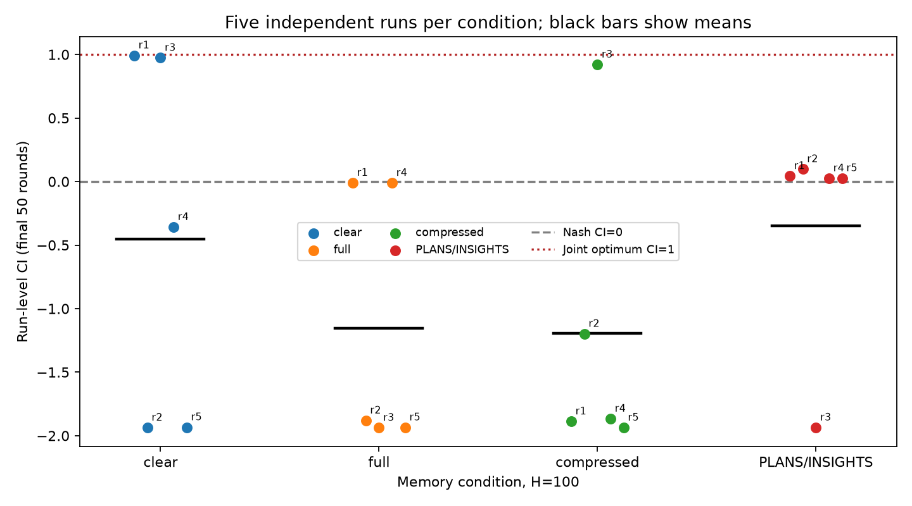
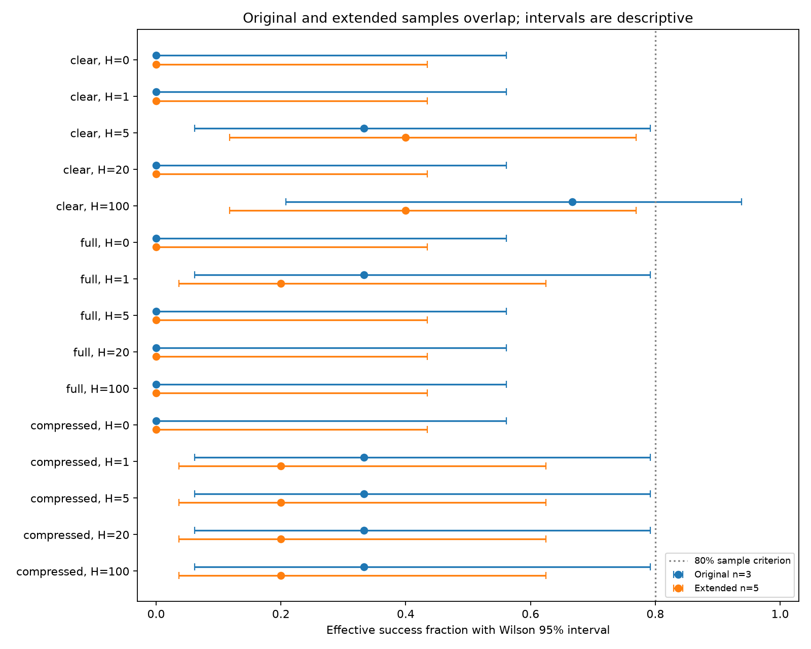

## Five-repeat extension: descriptive findings

The expanded bullet-memory matrix contains 75 complete 300-round runs across 15 conditions. The original 45 runs have 8 effective successes; the 30 added runs have 1. The full matrix has 9/75 effective successes and 69/75 price-criterion successes. These pooled counts describe coverage; each condition remains the unit of comparison.

Across the 15 cells, mean CI ranges from -1.945 to -0.142; within-cell sample standard deviations range from 0.000 to 1.460. Extending the sample changes cell mean CI by -0.518 to +0.136. Wilson interval widths range from 0.561–0.731 at n=3 and 0.434–0.652 at n=5; widths decrease in 15/15 cells. Interval widths depend on the observed success count as well as sample size, so an increase in repeats need not narrow every realized interval.

0 of 15 cells meet the predefined 80% sample effective-success criterion, which requires at least 4/5 successful runs at n=5. The minimum tested effective H is reported separately for each bullet-memory mode in `live/minimum_tested_effective_H.json`; it is not a population threshold.

The separately added H100 paper-reference condition contains 5 new complete runs, with 0/5 effective successes (Wilson 95% interval [0.000, 0.434]). Its mean CI is -0.348, sample standard deviation 0.888, and run-level range [-1.936, 0.098]. These observations are not pooled with full bullet memory or historical pilots.

The extension and new architectural condition were requested after inspecting the original results. Five repeats remain a small sample. Repeats 4–5 are a separate descriptive cohort, not a randomized time contrast; original and extended estimates overlap and must not be treated as independent samples. New paper-reference labels 1–3 denote additional independent runs, not historical execution alongside the original repeats or matched random seeds. Execution-time/model-service differences and post-result design changes limit causal and confirmatory interpretations. No post hoc significance test is used to decide whether to stop or favor a condition.

The added bullet repeats and all five formal paper-reference trajectories switched from API-key Chat Completions to ChatGPT-subscription Responses at saved checkpoints. The model, low reasoning level, original user prompt text, and memory rules were retained; the subscription route omits the original output-token caps and transport-specific controls. No interface-equivalence experiment was performed. Cohort and architectural differences therefore cannot be attributed solely to repeat randomness or memory representation; the interface change is an additional limitation. Exact switch checkpoints and wire requests are retained in the resume manifests and raw data.

See `live/extension_precision.csv` for every condition and cohort, including success fractions, Wilson intervals, CI means, sample standard deviations, ranges, and descriptive bootstrap intervals. The two-run added cohort is particularly imprecise.
