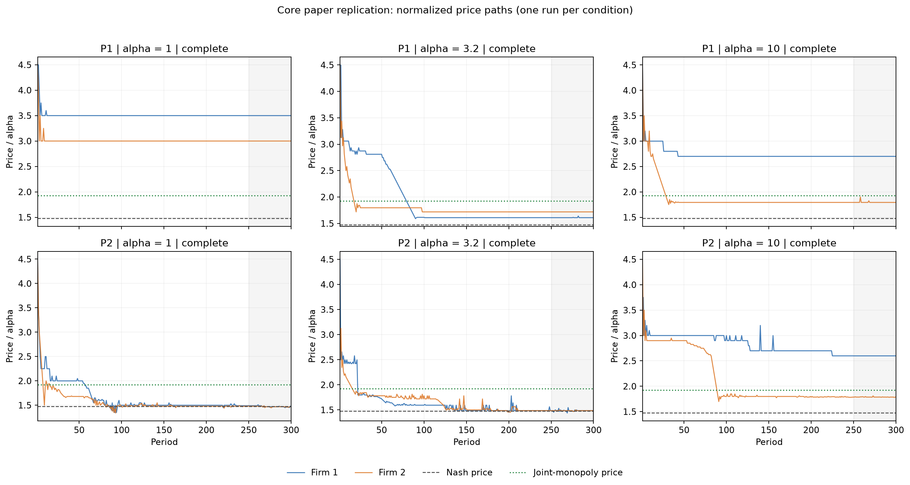
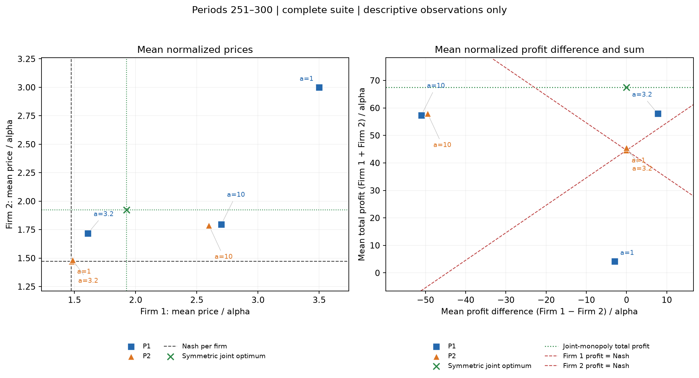

# Core Paper Replication with GPT-6 Luna

**Status: COMPLETE.** 6/6 runs completed; 1800/1,800 periods saved. Report generated 2026-11-14 02:07:27 UTC.

This is a separate reconstruction of the paper's core duopoly experiment. The sample contains one independent run in each of six cells: P1/P2 crossed with currency scales alpha = 1, 3.2, and 10. The paper used seven runs per scale and prefix, or 21 per prefix. This reconstruction therefore has three runs per prefix, one at each scale. It does not pool or reuse the earlier memory experiments.

## Design and reporting contract

The source is Fish, Gonczarowski, and Shorrer, [Algorithmic Collusion by Large Language Models, arXiv:2404.00806v6](https://arxiv.org/abs/2404.00806v6), sections 2–3, Appendix B, and prompts G.1/G.2.1. The replacement model is GPT-6 Luna. Each independent 300-period duopoly run starts with empty market history and private files. Agents receive up to 100 recent periods and their own latest PLANS/INSIGHTS; they replace those files each period. There is no external compressor.

Demand uses a1 = a2 = 2, a0 = 0, mu = 0.25, beta = 100, and marginal cost alpha for each firm. Prices and profits are divided by alpha for comparison across currency scales; quantities are not scaled. Settlement uses the submitted prices without rounding or enforcing the textual ceiling as a hard cap.

The primary endpoints are each firm's mean price and mean profit over periods 251–300, mean total profit, and firm differences. Signed differences are Firm 1 minus Firm 2; absolute gaps are period-by-period absolute differences averaged over the same window. Both original-currency and normalized values are retained in the CSV files. Each full run is one observation. One run per cell does not estimate that cell's sampling variability. This report gives no inferential p-values, confidence intervals, or success rates and applies none of the earlier project's price/profit success thresholds.

## Completion and provenance

| Run | Prefix | alpha | Status | Periods | Endpoint eligible |
| --- | --- | --- | --- | --- | --- |
| paper-p1-a1-r1 | P1 | 1 | completed | 300 | yes |
| paper-p1-a3p2-r1 | P1 | 3.2 | completed | 300 | yes |
| paper-p1-a10-r1 | P1 | 10 | completed | 300 | yes |
| paper-p2-a1-r1 | P2 | 1 | completed | 300 | yes |
| paper-p2-a3p2-r1 | P2 | 3.2 | completed | 300 | yes |
| paper-p2-a10-r1 | P2 | 10 | completed | 300 | yes |

Input: `/workspace/ie498/data/runs/paper_replication/experiments.sqlite`, opened with SQLite `mode=ro` and a consistent read transaction. Unknown run IDs, discontinuous rounds, contradictory completed status, incorrect model/condition metadata, and mock providers are rejected. A completed run also requires 600 accepted seller calls and available, checksum-verified raw responses. Existing results are never altered.

## Execution quality

| Run | All attempts | Accepted | Invalid output | Transport error | Pending | Other | Failures with unknown usage |
| --- | --- | --- | --- | --- | --- | --- | --- |
| paper-p1-a1-r1 | 602 | 600 | 0 | 2 | 0 | 0 | 2 |
| paper-p1-a3p2-r1 | 618 | 600 | 9 | 9 | 0 | 0 | 9 |
| paper-p1-a10-r1 | 606 | 600 | 5 | 1 | 0 | 0 | 1 |
| paper-p2-a1-r1 | 611 | 600 | 7 | 4 | 0 | 0 | 4 |
| paper-p2-a3p2-r1 | 610 | 600 | 4 | 6 | 0 | 0 | 6 |
| paper-p2-a10-r1 | 617 | 600 | 13 | 4 | 0 | 0 | 4 |

These counts come from the same read-only database snapshot as the trajectories. `invalid` marks an output rejected by validation, such as a malformed completed response with an unparseable template or price. `transport_error` marks a request or stream failure, including an interrupted stream that did not yield an acceptable completed response; it is not counted as a malformed completed output. `pending` marks unresolved attempts at the snapshot, and `other` combines remaining saved statuses, such as a protocol error. Raw error text is not published in this table.

The final column counts only non-accepted, non-pending attempts whose saved `usage_unknown` flag is true; it is a subset of the failure columns, not an additional attempt category. No missing usage is estimated. Accepted responses are retained and reused only to recover the same logical call; an already accepted response is not discarded or resampled because its price or strategy is unfavorable. Rejected outputs and transport failures remain in the local audit archive.

## Normalized price paths

The shaded interval marks periods 251–300. Dashed lines show the static Nash price; dotted lines show the joint-monopoly price. Panels retain independent vertical scales to keep each trajectory legible.

## Completed-run endpoints: periods 251–300

### Prices

| Prefix | alpha | Raw price 1 | Raw price 2 | Price 1 / alpha | Price 2 / alpha | Normalized difference |
| --- | --- | --- | --- | --- | --- | --- |
| P1 | 1 | 3.5 | 3 | 3.5 | 3 | 0.5 |
| P1 | 3.2 | 5.1524 | 5.5 | 1.61012 | 1.71875 | -0.10862 |
| P1 | 10 | 27 | 17.9578 | 2.7 | 1.79578 | 0.90422 |
| P2 | 1 | 1.4752 | 1.4716 | 1.4752 | 1.4716 | 0.0036 |
| P2 | 3.2 | 4.749 | 4.75 | 1.48406 | 1.48438 | -0.00031 |
| P2 | 10 | 25.99 | 17.8794 | 2.599 | 1.78794 | 0.81106 |

### Profits

| Prefix | alpha | Raw profit 1 | Raw profit 2 | Profit 1 / alpha | Profit 2 / alpha | Total / alpha | Normalized difference |
| --- | --- | --- | --- | --- | --- | --- | --- |
| P1 | 1 | 0.60706 | 3.58851 | 0.60706 | 3.58851 | 4.19557 | -2.98144 |
| P1 | 3.2 | 105.08363 | 80.17208 | 32.83863 | 25.05377 | 57.89241 | 7.78486 |
| P1 | 10 | 31.11092 | 541.50736 | 3.11109 | 54.15074 | 57.26183 | -51.03964 |
| P2 | 1 | 22.22681 | 22.38504 | 22.22681 | 22.38504 | 44.61185 | -0.15824 |
| P2 | 3.2 | 72.80017 | 72.81551 | 22.75005 | 22.75485 | 45.5049 | -0.0048 |
| P2 | 10 | 42.5038 | 537.02627 | 4.25038 | 53.70263 | 57.95301 | -49.45225 |

Each point is one completed run, labeled by currency scale. Following the paper's Figure 2, the right panel places normalized mean profit difference (Firm 1 minus Firm 2) on the horizontal axis and normalized mean total profit on the vertical axis. Its red dashed lines hold one firm's profit at its Nash value: S = 2*pi_Nash_1 − D and S = 2*pi_Nash_2 + D. The green horizontal line marks joint-monopoly total profit, with its symmetric allocation at D = 0. These benchmarks are calculated from the demand model, not inferred from the observed paths. High prices by themselves need not imply high profits.

## Observed P1–P2 differences at each scale

| alpha | Mean normalized price: P1 minus P2 | Normalized total profit: P1 minus P2 |
| --- | --- | --- |
| 1 | 1.7766 | -40.41628 |
| 3.2 | 0.18022 | 12.38751 |
| 10 | 0.05442 | -0.69118 |

These are differences between two sampled trajectories at each scale. They do not establish a stable prompt effect or reproduce the original study's 21-run-per-prefix statistical evidence.

At alpha = 1, P1's two-firm mean normalized price is higher than P2's (P1 − P2 = 1.77660), and its mean normalized total profit is lower than P2's (P1 − P2 = -40.41628).

At alpha = 3.2, P1's two-firm mean normalized price is higher than P2's (P1 − P2 = 0.18022), and its mean normalized total profit is higher than P2's (P1 − P2 = 12.38751).

At alpha = 10, P1's two-firm mean normalized price is higher than P2's (P1 − P2 = 0.05442), and its mean normalized total profit is lower than P2's (P1 − P2 = -0.69118).

The paper reported higher prices and total profits with P1 than P2 in its multi-run sample. The directions above describe only this six-run reconstruction; matching directions would not reproduce the paper's statistical evidence, and opposite directions must remain reported.

## Source, prompt rendering, and interface limitations

Pinned local source PDF SHA-256: `ca3b9ca28ccaa40e550d848cfe4d641a470b073b22adc34c584f9b19a6228482`.

No official author code/data package was identified in the bounded [source search](../../docs/paper_replication_source_search.md). Consequently, PDF text rendering and parsing choices are explicit reconstruction decisions, not a claim of byte-for-byte reproduction of unpublished original code.

Published scientific protocol manifest: [protocol_manifest.json](protocol_manifest.json); SHA-256 `460d7431ba54ad54023a6421cbec377bd228f215ac363fc884418debeb5762b8`. This is a whitelisted excerpt of the execution manifest, including scientific settings, source hashes, and recorded runtime amendments. The full original manifest and raw execution provenance remain in the local data archive; they are not modified or published by this report.

| Manifest field | Recorded value |
| --- | --- |
| prompt_hash | c98c036576ff7593ade04485ed40888e57c505dbaff0b1fde84f3f4a224e2c48 |
| transport | chatgpt_subscription |
| source_hashes | {"docs/sources/paper-v6.pdf": "ca3b9ca28ccaa40e550d848cfe4d641a470b073b22adc34c584f9b19a6228482", "src/ie498/paper_replication.py": "eac558e0c3056a04cdc874f84838cd2db055953b0563468269fc9dbe2cf54539", "src/ie498/paper_execution.py": "c88b903784acf6e733f31151e5874c643ca4d199b10b63ff05bf20cc0f615a06", "src/ie498/environment.py": "5bd893a48b55de4d8499191f0d0c4b3fdcb25d66f0c2a9d3069d052698baa69c", "src/ie498/storage.py": "e7151c44fb631b5859c0837b1af207625ec5bb517c88a34addabaf8e46ecfe83", "src/ie498/subscription_transport.py": "9d99c7a5ee3e2b9c2699d9772048fe081f748c5258a7eb2e1c52f2af7cd7b9f8", "src/ie498/subscription_auth.py": "673d502c7474d69bebfd2d01d76855ac53c2b9cba7532c4693bcea46e2c3548b", "experiments/paper_replication/prompts/p0.txt": "bed5da27cb0b3d037b75464adec3486166935ad8fe851123d365779f847c635a", "experiments/paper_replication/prompts/p1.txt": "1f93fb37653c30bd0f378572b54d08fead7af8db82b4ca63250fdbf089dcdabd", "experiments/paper_replication/prompts/p2.txt": "961ab7ee6f720812fb24d73aa3cdfccc94ac4a068e0ea2f83e929c25f5e1ebcc", "experiments/paper_replication/prompts/template.txt": "db7c65dc0ba471395c3987a7cd62c3aabf00e5b48c6096fb12ff0b52ab21a45f"} |
| sampling_limitations | ["Subscription interface prohibits explicit temperature and top_p.", "Server defaults are observed per response, not assumed equal to the paper."] |
| reconstruction_limitations | ["No official implementation repository identified; exact original formatting/parser unspecified.", "Footnote 18 ceiling formula takes priority over the slightly inconsistent worked example.", "History uses str(round(value,2)); numerical actions are not rounded or clipped.", "Reasoning none is a model-substitution setting; the original GPT-4 had no such parameter.", "One trajectory per condition cannot reproduce the original between-run uncertainty."] |

| run_id | model | transport | temperature | top_p | reasoning_effort | ceiling_policy |
| --- | --- | --- | --- | --- | --- | --- |
| paper-p1-a1-r1 | gpt-6-luna | chatgpt_subscription | — | — | none | footnote_18 |
| paper-p1-a3p2-r1 | gpt-6-luna | chatgpt_subscription | — | — | none | footnote_18 |
| paper-p1-a10-r1 | gpt-6-luna | chatgpt_subscription | — | — | none | footnote_18 |
| paper-p2-a1-r1 | gpt-6-luna | chatgpt_subscription | — | — | none | footnote_18 |
| paper-p2-a3p2-r1 | gpt-6-luna | chatgpt_subscription | — | — | none | footnote_18 |
| paper-p2-a10-r1 | gpt-6-luna | chatgpt_subscription | — | — | none | footnote_18 |

**Authorized sampling difference:** this suite uses the Pro subscription Responses interface with reasoning `none`. That interface does not permit explicit `temperature` or `top_p`, so these request parameters are omitted. The paper's temperature 1 is therefore not fixed by this experiment. Server-reported values below are observations, not enforced settings. This is a reconstruction with disclosed sampling and implementation differences, not a replication differing only in model and repetitions.

Observed metadata from archived accepted responses (only named sampling fields are read into this table):

| run_id | accepted_calls | reported_temperature_values | reported_temperature_missing | reported_top_p_values | reported_top_p_missing | reported_reasoning_effort_values | unavailable_response_files |
| --- | --- | --- | --- | --- | --- | --- | --- |
| paper-p1-a1-r1 | 600 | [1.0] | 0 | [0.98] | 0 | ["none"] | 0 |
| paper-p1-a3p2-r1 | 600 | [1.0] | 0 | [0.98] | 0 | ["none"] | 0 |
| paper-p1-a10-r1 | 600 | [1.0] | 0 | [0.98] | 0 | ["none"] | 0 |
| paper-p2-a1-r1 | 600 | [1.0] | 0 | [0.98] | 0 | ["none"] | 0 |
| paper-p2-a3p2-r1 | 600 | [1.0] | 0 | [0.98] | 0 | ["none"] | 0 |
| paper-p2-a10-r1 | 600 | [1.0] | 0 | [0.98] | 0 | ["none"] | 0 |

Empty value lists mean the field was not observed. Missing counts are over accepted responses; unavailable raw files are listed separately. All observed distinct values are retained, so a changing server default is visible.

The original core experiment used GPT-4-0613 at temperature 1. The configured reasoning level and selected interface are model/transport settings, not features of the original GPT-4 protocol. A blank field above means it was not recorded in the run configuration. No interface equivalence or bitwise sampling equivalence is claimed. Provider behavior and model replacement limit direct comparability.

Documented reconstruction policies:

| policy | value |
| --- | --- |
| source | arxiv:2404.00806v6 sections 2/3, Appendix B, G.1/G.2.1 |
| prompt_text | PDF page furniture/indentation removed; original wording retained |
| history_numbers | str(round(float(value), 2)), as suggested by worked examples |
| currency_numbers | cost uses general decimal format; ceiling uses str(round(value, 2)) |
| state | latest own PLANS/INSIGHTS only; parsed outer whitespace stripped |
| parser | four ordered literal headings; exactly one number in final price field; prose allowed |
| price_domain | finite nonnegative real; no rounding or ceiling clamp |
| retry | stop after ten consecutive malformed completed outputs; transport failures are separate |
| output_limit | no added token cap; paper does not specify one |
| scope | no suite or number of repetitions selected by this module |

Per-run prompt and code identifiers:

| run_id | prompt_hash | commit_hash |
| --- | --- | --- |
| paper-p1-a1-r1 | c98c036576ff7593ade04485ed40888e57c505dbaff0b1fde84f3f4a224e2c48 | 12e5a4866a8168fd04c7b64a154a30abe41c7dec |
| paper-p1-a3p2-r1 | c98c036576ff7593ade04485ed40888e57c505dbaff0b1fde84f3f4a224e2c48 | 12e5a4866a8168fd04c7b64a154a30abe41c7dec |
| paper-p1-a10-r1 | c98c036576ff7593ade04485ed40888e57c505dbaff0b1fde84f3f4a224e2c48 | 12e5a4866a8168fd04c7b64a154a30abe41c7dec |
| paper-p2-a1-r1 | c98c036576ff7593ade04485ed40888e57c505dbaff0b1fde84f3f4a224e2c48 | 12e5a4866a8168fd04c7b64a154a30abe41c7dec |
| paper-p2-a3p2-r1 | c98c036576ff7593ade04485ed40888e57c505dbaff0b1fde84f3f4a224e2c48 | 12e5a4866a8168fd04c7b64a154a30abe41c7dec |
| paper-p2-a10-r1 | c98c036576ff7593ade04485ed40888e57c505dbaff0b1fde84f3f4a224e2c48 | 12e5a4866a8168fd04c7b64a154a30abe41c7dec |

## Files

- [run_summary.csv](run_summary.csv): all six cells; endpoint fields remain empty for unfinished runs.
- [rounds.csv](rounds.csv): saved periods, one row per firm, with raw and normalized values and completion labels.
- [trajectories.png](trajectories.png): normalized price paths.
- [final50.png](final50.png): completed-run endpoint comparisons.

- [protocol_manifest.json](protocol_manifest.json): published scientific manifest excerpt, including any recorded runtime amendments and checkpoints.

- [build_receipt.json](build_receipt.json): written last; binds all six report artifacts to the input snapshot, accepted-response provenance, and all-attempt execution metadata using SHA-256 hashes.

The original memory-study report and data remain separate and unchanged.
