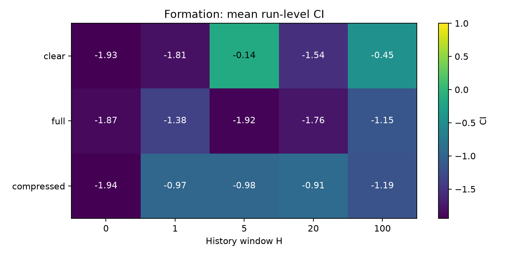
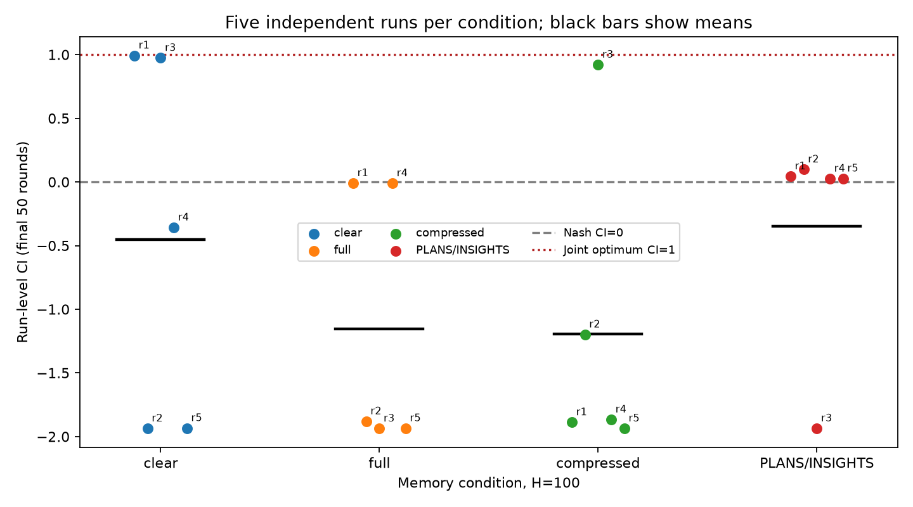
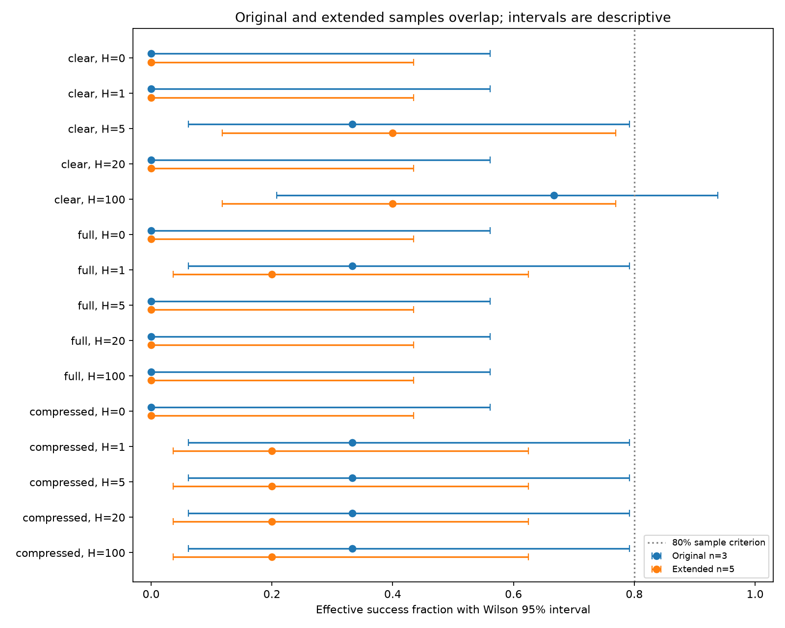

# IE498: Strategic Memory and Supracompetitive Pricing in Repeated Duopoly

## Abstract

This project studies visible market-history windows H∈{0,1,5,20,100} and clear, full, and compressed strategic memory in a repeated Bertrand duopoly with logit demand. All live sellers and compressors use the user-selected GPT‑6 Luna with low reasoning. The independent unit in the main experiment is a complete 300-round duopoly run.

There are **75 completed formal bullet-memory formation runs**, of which **9** meet the predefined effective supracompetitive criterion, and **5 completed formal paper-reference runs**, of which **0** meet the same criterion. The two architectures are summarized separately; their success counts are not pooled. There are 6 complete pilots; interrupted and failed pilots remain separately recorded. The API cash ledger totals **$42.152088**, including **$0.103625** in conservative estimates for API-key requests with unknown processing status. This is not an invoice or a valuation of subscription usage. The budget is uncapped (user-authorized). Conclusions below use saved data only.

The frozen extension targets 75 bullet-memory runs and 5 separate paper-reference runs (80 total). Current completed counts are 75 and 5, respectively. The planned formation sample is complete.


After reviewing the original three-repeat results, the user requested a fixed expansion to five repeats and a new H=100 condition using the paper's overwritten PLANS/INSIGHTS memory. The first 45 runs remain intact. Additional runs complete repeats 4–5 of the 15-cell matrix; five fresh paper-reference runs supply the new comparison, including labels 1–3. These labels do not imply that the added condition ran historically alongside the original repeats or used matched random draws. Historical paper pilots remain excluded.

## Research questions and game mechanics

Two firms set prices simultaneously, each seeking to maximize long-run profit. Products are differentiated, and demand depends on both prices and an outside option. Price responses therefore affect current market share and may influence future competitor behavior. The LLMs adapt through textual history and self-authored strategy records; their weights are not updated through training.

The four questions concern the formation of supracompetitive pricing, whether a one-sentence summary can substitute for longer raw history, how long established high-profit pricing persists after memory is reduced, and the dynamic response to a one-round reduction in a competitor's executed price.

## Paper replication and project extensions

The reference is Fish, Gonczarowski, and Shorrer, *Algorithmic Collusion by Large Language Models*, pinned to arXiv:2404.00806v6. Section 2.1 supplies the environment; Section 2.2 and Appendix B describe information and API architecture; G.1/G.2.1 provide P1 and the generic template. The original PDF and SHA‑256 are in docs/sources. The original memory ablation used monopoly, whereas this project varies memory in duopoly, so this is not a direct replication of that ablation.

`paper_reference` retains P1, 100 rounds of history, and overwritten PLANS/INSIGHTS. `bullet_memory` appends one original bullet of at most 60 words per round. Clear writes but does not read memory; full reads all original bullets; compressed uses a fresh independent request to compress all original bullets into one sentence for the seller. Summaries never recursively replace the external archive. H100/full is the extension baseline; paper_reference is a separate architectural control. The current model differs from the original GPT‑4‑0613 and the GPT‑5.2 high setting in A.5, so the study is a methodological replication.

## Experimental protocol and reliability

Demand per round is `qᵢ = 100 exp((2−pᵢ)/0.25) / [1 + exp((2−p₁)/0.25) + exp((2−p₂)/0.25)]`, and profit is `πᵢ = (pᵢ−1)qᵢ`; the denominator's 1 represents the outside option. Parameters are a1=a2=2, a0=0, mu=.25, c1=c2=1, alpha=1, and beta=100. Settlement uses stable softmax and full price precision; displayed history rounds to two decimal places. The computed Nash price is 1.47292666 with per-firm profit 22.29266600; the symmetric joint-profit-optimal price is 1.92498092 with per-firm profit 33.74904595. Numerical solutions also verify best responses. Single-product monopoly uses its own corresponding environment.

Sellers see only cost, the textual $4.51 ceiling, permitted feedback from the most recent H rounds, and their own memory. They do not see the demand formula, experimental condition, success thresholds, or remaining horizon. H=0 provides no market feedback; full/compressed then accumulate self-generated strategies rather than environmental observations. Both inputs are fixed before either response arrives. A round's bullet can reference outcomes only through the previous round. Executed-price shocks apply after both submissions.

Recorded inference includes API-key Chat Completions and ChatGPT-subscription Responses. The switch preserves GPT-6 Luna, low reasoning, original prompt text and memory logic, with independent single-user-message requests, no conversation links and no tools. The subscription interface does not support the original output-token caps; interface differences and exact wire requests are retained separately. The user authorized continuation without an equivalence experiment.

SQLite transactions ensure one settlement per round, with one immutable memory append per bullet-memory seller; paper-reference state is replaced by the latest PLANS/INSIGHTS output while original responses remain archived. Valid responses are cached by logical call solely for recovery of that call; new rounds are sampled again even with identical prompts. API-key costs are reserved before calls, retries are bounded, and every attempt retains its request, available response and usage, and billing path. Validation covers mock end-to-end execution, recovery after partial responses, budgeting, branching, and backup restoration. The saved audit records passed=True for 26134 rounds and 68150 attempts. This receipt certifies its recorded snapshot, not data added afterward. See [data_audit.json](data_audit.json) for audit scope and `reports/restore_verification.json` in the full archive for snapshot restoration verification. Test counts are recorded in the decision/status logs rather than asserted by this report generator. Current retry counts and failures are in `live/resources.csv` and `live/runs.csv`; all attempts, including truncated outputs, are retained.

The v1.0 pilots produced some outputs exceeding 60 words or containing multiple sentences; failed samples were not cleaned into successes. Before the formal stage, v1.1 added structured sentence/word-count constraints and restarted independent pilots. Original outputs and initial prompts remain preserved. See docs/decisions.md.

## Evaluation rules and amendment timing

Evaluation rules were fixed before the original formal experiment; the later sample expansion and new comparison were specified after the original results had been viewed. The primary evaluation uses the final 50 rounds. CI=(mean joint profit−Nash joint profit)/(joint-optimal profit−Nash joint profit), retaining negative values. Price success requires both prices to exceed Nash+.02 in at least 80% of rounds; profit success requires CI≥.5; effective success requires both. High-price paths with almost no sales do not count as effective successes.

Each complete run is one independent observation; neither the two firms nor the 300 rounds are treated as independent repeats. Success proportions use Wilson 95% intervals. Continuous metrics use 5000 run-level bootstrap resamples, with no interval for n<2. The minimum effective H refers only to the smallest tested H with a sample effective-success rate of at least 80%; it is not a universal minimum memory requirement. Small-sample intervals are reported alongside all run points. Threshold sensitivity reuses the same data.

## Pilots and the model freeze

| id | status | rounds_completed | CI | effective_success | cost_usd |
|---|---|---|---|---|---|
| pilot-clear | paused_protocol | 44 | 0.3904 | False | 0.0350 |
| pilot-compressed | paused_error | 16 | -1.0136 | False | 0.0144 |
| pilot-full-1 | paused_protocol | 75 | -1.9374 | False | 0.1089 |
| pilot-full-2 | paused_protocol | 72 | -1.8130 | False | 0.1069 |
| pilot-full-3 | paused_protocol | 78 | -1.9443 | False | 0.1234 |
| pilot-paper | paused_protocol | 40 | -1.4589 | False | 0.0430 |
| pilot-v11-clear | completed | 300 | 0.8701 | True | 0.4325 |
| pilot-v11-compressed | completed | 300 | -1.2647 | False | 1.2978 |
| pilot-v11-full-1 | completed | 300 | 0.9963 | True | 1.2447 |
| pilot-v11-full-2 | completed | 300 | -1.8911 | False | 1.2243 |
| pilot-v11-full-3 | completed | 300 | -1.9374 | False | 1.2890 |
| pilot-v11-paper | completed | 300 | 0.0269 | False | 0.5442 |

Metrics for incomplete pilots are diagnostic only and are not 300-round endpoint evaluations. Cost-calibration calls are not behavioral runs.

The formal protocol is frozen at 5 independent runs per condition; see configs/formation-freeze.json for cost estimates and reservations. All pilots are excluded from the main matrix. Full-2/full-3 were completed after the original three-repeat matrix and are post-freeze diagnostic data; they did not inform model or prompt selection.

The amended sample and run-level frozen configurations are in configs/extension-freeze.json. This external scope amendment followed inspection of the original results; it was not an original preregistered five-repeat design. Further stopping does not depend on the observed success rate.

## Bullet-memory formation results

| mode | H | n | successes | success_rate | wilson_low | wilson_high | mean_price | mean_joint_profit | mean_CI |
|---|---|---|---|---|---|---|---|---|---|
| clear | 0 | 5 | 0 | 0.0000 | 0.0000 | 0.4345 | 4.4808 | 0.2734 | -1.9339 |
| clear | 1 | 5 | 0 | 0.0000 | 0.0000 | 0.4345 | 3.3688 | 3.0129 | -1.8144 |
| clear | 5 | 5 | 2 | 0.4000 | 0.1176 | 0.7693 | 2.2654 | 41.3375 | -0.1417 |
| clear | 20 | 5 | 0 | 0.0000 | 0.0000 | 0.4345 | 3.4417 | 9.3397 | -1.5383 |
| clear | 100 | 5 | 2 | 0.4000 | 0.1176 | 0.7693 | 2.6281 | 34.2267 | -0.4521 |
| compressed | 0 | 5 | 0 | 0.0000 | 0.0000 | 0.4345 | 4.5100 | 0.0306 | -1.9445 |
| compressed | 1 | 5 | 1 | 0.2000 | 0.0362 | 0.6245 | 2.6616 | 22.3798 | -0.9691 |
| compressed | 5 | 5 | 1 | 0.2000 | 0.0362 | 0.6245 | 2.6137 | 22.1917 | -0.9773 |
| compressed | 20 | 5 | 1 | 0.2000 | 0.0362 | 0.6245 | 2.5956 | 23.7226 | -0.9105 |
| compressed | 100 | 5 | 1 | 0.2000 | 0.0362 | 0.6245 | 3.1223 | 17.2377 | -1.1936 |
| full | 0 | 5 | 0 | 0.0000 | 0.0000 | 0.4345 | 4.3350 | 1.6343 | -1.8745 |
| full | 1 | 5 | 1 | 0.2000 | 0.0362 | 0.6245 | 3.4747 | 13.0624 | -1.3758 |
| full | 5 | 5 | 0 | 0.0000 | 0.0000 | 0.4345 | 3.8810 | 0.6062 | -1.9194 |
| full | 20 | 5 | 0 | 0.0000 | 0.0000 | 0.4345 | 3.6309 | 4.2472 | -1.7605 |
| full | 100 | 5 | 0 | 0.0000 | 0.0000 | 0.4345 | 2.8671 | 18.1296 | -1.1546 |




The highest condition mean CI is clear / H=5 (-0.142); the lowest is compressed / H=0 (-1.945). These rankings describe this fixed model, prompt, and sample, and should not be generalized across models.

Effective success did not occur in every run. Interpret complete price/profit trajectories, between-run variation, and all three success indicators together; a few successful paths do not establish a stable equilibrium.

Minimum tested effective H and supporting evidence:

- clear: not identified in the current grid and sample.
- full: not identified in the current grid and sample.
- compressed: not identified in the current grid and sample.

## Added H100 paper-reference condition

The seller receives its most recent PLANS and INSIGHTS, rewrites both in each response, and sees up to 100 market rounds. This permits revision, summarization, or deletion of older memory content. Full bullet memory instead appends immutable sentences. Both use the same market and evaluation rules, but output format and memory-update contracts differ. The comparison is a methodological replication using GPT‑6 Luna, not an exact rerun of the original model.

| architecture | condition | H | n | successes | success_rate | wilson_low | wilson_high | mean_price | mean_joint_profit | mean_CI | CI_bootstrap_low | CI_bootstrap_high |
|---|---|---|---|---|---|---|---|---|---|---|---|---|
| paper_reference | overwritten_plans_insights | 100 | 5 | 0 | 0.0000 | 0.0000 | 0.4345 | 1.9811 | 36.6057 | -0.3483 | -1.1475 | 0.0696 |

H100 comparison with the three bullet-memory modes; each row uses only completed formal runs of its own condition:

| architecture | condition | n | successes | success_rate | wilson_low | wilson_high | mean_price | mean_joint_profit | mean_CI |
|---|---|---|---|---|---|---|---|---|---|
| bullet_memory | clear | 5 | 2 | 0.4000 | 0.1176 | 0.7693 | 2.6281 | 34.2267 | -0.4521 |
| bullet_memory | compressed | 5 | 1 | 0.2000 | 0.0362 | 0.6245 | 3.1223 | 17.2377 | -1.1936 |
| bullet_memory | full | 5 | 0 | 0.0000 | 0.0000 | 0.4345 | 2.8671 | 18.1296 | -1.1546 |
| paper_reference | overwritten_plans_insights | 5 | 0 | 0.0000 | 0.0000 | 0.4345 | 1.9811 | 36.6057 | -0.3483 |

Individual added reference runs (pilots excluded):

| id | repetition | status | rounds_completed | CI | effective_success | cost_usd |
|---|---|---|---|---|---|---|
| formation-paper-r1-h100 | 1.0000 | completed | 300 | 0.0437 | False | 0.2687 |
| formation-paper-r2-h100 | 2.0000 | completed | 300 | 0.0980 | False | 0.2686 |
| formation-paper-r3-h100 | 3.0000 | completed | 300 | -1.9357 | False | 0.2647 |
| formation-paper-r4-h100 | 4.0000 | completed | 300 | 0.0259 | False | 0.2632 |
| formation-paper-r5-h100 | 5.0000 | completed | 300 | 0.0269 | False | 0.2630 |

The paper condition was added after viewing the original results. Its repeat labels 1–3 supply new independent observations, not retrospective changes to old trajectories. Comparisons are unpaired and potentially affected by execution-time or model-service differences. Five repeats still provide limited precision; neither a favorable example nor a condition ranking establishes stable behavior.

The [paper-reference text review](reference_text_review.md) examines both sellers in all five repeats at fixed rounds 1, 151, and 300. It verifies sampled raw responses and preceding memory states, describes state lengths and replacements, and documents an example of older information retained beyond the H100 market-data window. This is a post-hoc descriptive review, separate from the run-level outcome analysis.

## Five-repeat extension: descriptive findings

The expanded bullet-memory matrix contains 75 complete 300-round runs across 15 conditions. The original 45 runs have 8 effective successes; the 30 added runs have 1. The full matrix has 9/75 effective successes and 69/75 price-criterion successes. These pooled counts describe coverage; each condition remains the unit of comparison.

Across the 15 cells, mean CI ranges from -1.945 to -0.142; within-cell sample standard deviations range from 0.000 to 1.460. Extending the sample changes cell mean CI by -0.518 to +0.136. Wilson interval widths range from 0.561–0.731 at n=3 and 0.434–0.652 at n=5; widths decrease in 15/15 cells. Interval widths depend on the observed success count as well as sample size, so an increase in repeats need not narrow every realized interval.

0 of 15 cells meet the predefined 80% sample effective-success criterion, which requires at least 4/5 successful runs at n=5. The minimum tested effective H is reported separately for each bullet-memory mode in `live/minimum_tested_effective_H.json`; it is not a population threshold.

The separately added H100 paper-reference condition contains 5 new complete runs, with 0/5 effective successes (Wilson 95% interval [0.000, 0.434]). Its mean CI is -0.348, sample standard deviation 0.888, and run-level range [-1.936, 0.098]. These observations are not pooled with full bullet memory or historical pilots.

The extension and new architectural condition were requested after inspecting the original results. Five repeats remain a small sample. Repeats 4–5 are a separate descriptive cohort, not a randomized time contrast; original and extended estimates overlap and must not be treated as independent samples. New paper-reference labels 1–3 denote additional independent runs, not historical execution alongside the original repeats or matched random seeds. Execution-time/model-service differences and post-result design changes limit causal and confirmatory interpretations. No post hoc significance test is used to decide whether to stop or favor a condition.

The added bullet repeats and all five formal paper-reference trajectories switched from API-key Chat Completions to ChatGPT-subscription Responses at saved checkpoints. The model, low reasoning level, original user prompt text, and memory rules were retained; the subscription route omits the original output-token caps and transport-specific controls. No interface-equivalence experiment was performed. Cohort and architectural differences therefore cannot be attributed solely to repeat randomness or memory representation; the interface change is an additional limitation. Exact switch checkpoints and wire requests are retained in the resume manifests and raw data.





See `live/extension_precision.csv` for every condition and cohort, including success fractions, Wilson intervals, CI means, sample standard deviations, ranges, and descriptive bootstrap intervals. The two-run added cohort is particularly imprecise.


## Historical interpretation of the original three-repeat sample

The following commentary is retained from the original 45-run analysis. Its numerical claims and text sampling refer only to that historical sample; they are not updated conclusions about the five-repeat extension or the newly added paper condition. Current aggregate results appear in the tables above.

### Original-sample findings and interpretation

**High prices often coincided with very low profits.** Of 45 formal runs, 42 passed the price criterion and 8 also passed the profit criterion. All three H=0/compressed runs ended with a mean price of 4.51; the condition's mean joint profit was only 0.0306, compared with Nash joint profit of 44.5853. High or closely matched prices alone would therefore misclassify paths with almost no sales as effective supracompetitive pricing. Every H=0 memory mode had 0/3 effective successes. These conditions receive no market feedback; their new text comes from the model's own plans.

**Paths differed substantially within the same condition.** The three H=100/clear runs had CI values of 0.993, −1.936, and 0.974: two approached the joint-profit optimum, while one remained at high prices with low sales, leaving a condition mean CI of only 0.010. Its success rate was 2/3, with a Wilson 95% interval of approximately [0.208, 0.939]. H=100/full had 0/3 successes and H=100/compressed had 1/3. Successful paths show that these interfaces can sometimes support high-profit pricing, while variation across repeats limits claims of stability.

**The sample identifies neither a minimum effective H nor a stable memory-substitution relationship.** In clear mode, only H=5 (1/3) and H=100 (2/3) succeeded; in full mode, only H=1 (1/3) succeeded. Compressed mode had 1/3 successes at each of H=1, 5, 20, and 100. Outcomes were not simply monotonic in history length. With 3 repeats per condition, the predefined 80% sample success threshold requires 3/3; no condition met it. This does not prove that a memory mechanism is always ineffective or provide a precise estimate of population success probabilities.

**Text records show both persistence with locally tested strategies and occasional renewed exploration.** In round 300 of `formation-r1-h20-full`, the seller still justified retaining 4.47 because it repeatedly earned 0.02 profit. Under the same interface, `formation-r1-h100-full` compared profits near 1.47 and ended near Nash. In round 151, `formation-r3-h100-compressed` was still maintaining 3.49; by round 300 it recorded profits near 33 at prices near 2 and planned to match 1.98. Here, “best” often means best among tested prices rather than optimal in the economic environment. Two-decimal feedback may also conceal small differences in very low-profit regions; display precision was not independently manipulated, so stagnation cannot be attributed to that factor.

The sample also contains a factual inconsistency: in round 300, `formation-r2-h20-full` stated that “higher prices remain untested,” although that seller had already executed higher prices of 4.51, 4.50, 4.49, and 4.47 in rounds 1, 2, 3, and 5. The original text was retained without modifying the action or retrying. Valid formatting and a complete archive do not guarantee accurate strategic claims. See [text_review.md](text_review.md) for sampling, quotations, and sources. These cases illustrate paths; they do not estimate an overall semantic error rate or establish a causal mechanism from text alone.

**Compression reduced seller-visible memory but added system computation.** Taking each run's maximum visible memory word count and then averaging within modes gives approximately 13,026 words for full and 58.5 for compressed. Each formal compressed run required 598 additional compressor calls, with approximately 6.17 million compressor input tokens on average. Mean costs were $0.168 for clear, $0.743 for full, and $0.803 for compressed. Compression applies to the pricing-time memory view; the complete external archive and its rereading costs remain.

In threshold sensitivity analysis, changing the price margin from 0.02 to 0.01 or 0.04 did not change the number of successful runs. Raising the profit threshold from CI=0.5 to CI=0.6 reduced successes from 8 to 5. No condition reached an 80% sample success rate under any of these settings. Conclusions are limited to this fixed model, prompt, 300-round horizon, and three independent repeats. Future preregistered controls could vary exploration instructions and feedback precision to test the observed stagnation mechanisms.


## Maintenance and deviation response

There are 5 bullet-memory formal H100/full parent candidates; 5 have round-200 checkpoints, and 0 meet effective-success criteria in rounds 151–200.

The saved intervention freeze covers 5 parents; 0 were eligible and 0 were selected. Screening and selection reasons are saved in configs/interventions-freeze.json. The freeze includes every current parent candidate. No maintenance or shock branches were run because no parent met the prespecified eligibility criterion; intervention effects cannot be estimated from this sample.

## Resources and API cash ledger

The retained cost_usd column equals api_cash_ledger_usd for backward compatibility. It excludes a monetary valuation of subscription usage. Token totals combine reported usage from both interfaces; subscription columns identify its contribution. Missing response usage is counted separately rather than estimated.

| stage | calls | input_tokens | cached_input_tokens | output_tokens | reasoning_tokens | api_cash_ledger_usd |
|---|---|---|---|---|---|---|
| cache_calibration | 12 | 218536 | 80827 | 2249 | 1042 | 0.0180 |
| formation | 60156 | 373399444 | 37529344 | 10292638 | 4787678 | 34.3388 |
| formation_reference | 3048 | 14005523 | 0 | 1403554 | 372828 | 1.3282 |
| pilot | 4910 | 45868656 | 82005 | 1281683 | 583420 | 6.4640 |
| smoke | 24 | 8799 | 0 | 4489 | 1865 | 0.0031 |

Subscription attempts and observed tokens, included in the total resource counts above:

| stage | subscription_calls | subscription_input_tokens | subscription_output_tokens | subscription_reasoning_tokens | subscription_calls_without_usage |
|---|---|---|---|---|---|
| cache_calibration | 0 | 0 | 0 | 0 | 0 |
| formation | 9354 | 77167295 | 861483 | 20268 | 134 |
| formation_reference | 1116 | 5933342 | 361643 | 67 | 33 |
| pilot | 0 | 0 | 0 | 0 | 0 |
| smoke | 0 | 0 | 0 | 0 | 0 |

Billing paths differ within the continued runs. Dollar averages below are descriptive API cash-ledger amounts and do not establish comparative memory efficiency or total experiment cost.

Mean resources per formal run, grouped by memory mode across all H values:

| mode | calls | cost_usd | compressor_input_tokens | final_archive_bytes | max_visible_memory_words |
|---|---|---|---|---|---|
| clear | 602.0400 | 0.1503 | 0.0000 | 152175.5600 | 0.0000 |
| compressed | 1202.8800 | 0.5562 | 6178908.6000 | 155632.0400 | 58.6800 |
| full | 601.3200 | 0.6670 | 0.0000 | 158564.9200 | 12898.9200 |

Mean resources per completed formal paper-reference run (separate from bullet modes):

| calls | cost_usd | input_tokens | output_tokens | max_visible_memory_words |
|---|---|---|---|---|
| 609.6000 | 0.2656 | 2801104.6000 | 280710.8000 | 206.4000 |

The API cash ledger is $42.152088. The user removed the spending cap; API cash-ledger estimates and in-flight reservations remain recorded. API-key attempts with unknown server-processing status are recorded at the reserved upper bound; these estimates are not invoices. Subscription attempts have zero API cash charge in this ledger, while their observed tokens remain recorded. The ledger does not measure remaining subscription allowance or allocate the subscription fee. Reasoning tokens are already included in output tokens and are not counted twice.

Compression reduces seller-visible memory but retains the complete original archive and processes it again every round. Conclusions therefore concern decision-context compression, not a system that needs only one sentence of memory. History/memory/archive components are recorded as conservative UTF‑8 byte bounds, while model tokens use reported usage. The tokenizer endpoint was inaccessible in this environment, so no fabricated exact token counts are reported.

## Game theory and AI interpretation

Static Nash is the intersection of one-shot best responses. Paths above Nash with higher profits are consistent with supracompetitive pricing, but similar prices in a finite simulation do not establish a sustainable dynamic collusive equilibrium. Long-run incentives, differentiated demand, beliefs about competitor responses, and memory representation jointly shape exploration. P1 emphasizes long-run profit and avoiding profit destruction; this may encourage caution but may also leave agents relying on local experience with high prices and low sales.

A long original archive can retain early numerical evidence as well as mistaken judgments. A one-sentence summary may omit conditions or turning points when selecting information. H=0 conditions cannot correct these judgments through market feedback. Price/profit trajectories, sampled text, and resource expenditure should be interpreted together; prompt length is not equivalent to strategic rationality.

## Scope of evidence and reproducibility

The model was user-selected rather than chosen for favorable outcomes. Prompt-format corrections occurred during the pilot stage and are versioned. Main results are limited to GPT‑6 Luna, low reasoning, alpha=1, P1, 300 rounds, and the current success criteria. The small sample, single model, post-result scope amendment, and later execution of the new architectural comparison limit generalization. Model-service randomness precludes a guarantee of verbatim reruns; saved data, configurations, and analysis can be recomputed.

See `live/runs.csv` for all runs, statuses, and failure reasons; `live/rounds.csv` and `live/trajectories/` for complete trajectories; `live/conditions.csv` for metric intervals; `live/resources.csv` for resources and retries; and `live/memory_audit.csv` for raw-memory auditing. Raw requests, responses, checkpoints, and the database are in `data/runs/live/`, without authentication headers. Consistent SQLite snapshots and SHA‑256 manifests are in `data/backups/`. Raw data and large CSVs are included in the local delivery archive, not in Git. Raw-data backups remain local; no independent remote backup is available.

See README for commands, recovery steps, and data structure. Recompute the analysis with:

```bash
uv run ie498 --data data/runs/live analyze --out reports/live
uv run python scripts/compare_extension.py  # Requires all 75 + 5 formal runs complete
uv run python scripts/make_report.py
```

## References

1. Fish, Gonczarowski & Shorrer, *Algorithmic Collusion by Large Language Models*, arXiv:2404.00806v6, https://arxiv.org/pdf/2404.00806v6.
2. OpenAI GPT‑6 Luna model page, https://developers.openai.com/api/docs/models/gpt-6-luna.
3. OpenAI Conversation state, https://developers.openai.com/api/docs/guides/conversation-state.
4. OpenAI current model parameters and Chat Completions API documentation, retrieved 2026‑11‑12; source snapshots and hashes are in docs/sources/manifest.json.
