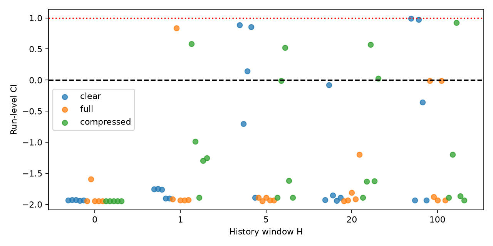

# IE498: Strategic Memory and Supracompetitive Pricing in Repeated Duopoly

## Abstract

This project studies visible market-history windows H∈{0,1,5,20,100} and clear, full, and compressed strategic memory in a repeated Bertrand duopoly with logit demand. All live sellers and compressors use the user-selected GPT‑6 Luna with low reasoning. The independent unit in the main experiment is a complete 300-round duopoly run.

There are **45 completed formal formation runs**, of which **8** meet the predefined effective supracompetitive criterion. There are 6 complete pilots; interrupted and failed pilots remain separately recorded. The cost ledger totals **$32.199045**, including **$0.103625** in conservative charges for requests with unknown processing status. The budget is uncapped (user-authorized). Conclusions below use saved data only. The 30 unstarted plans in batches 4 and 5 were canceled at the user's request and incurred no API costs.

## Research questions and game mechanics

Two firms set prices simultaneously, each seeking to maximize long-run profit. Products are differentiated, and demand depends on both prices and an outside option. Price responses therefore affect current market share and may influence future competitor behavior. The LLMs adapt through textual history and self-authored strategy records; their weights are not updated through training.

The four questions concern the formation of supracompetitive pricing, whether a one-sentence summary can substitute for longer raw history, how long established high-profit pricing persists after memory is reduced, and the dynamic response to a one-round reduction in a competitor's executed price.

## Paper replication and project extensions

The reference is Fish, Gonczarowski, and Shorrer, *Algorithmic Collusion by Large Language Models*, pinned to arXiv:2404.00806v6. Section 2.1 supplies the environment; Section 2.2 and Appendix B describe information and API architecture; G.1/G.2.1 provide P1 and the generic template. The original PDF and SHA‑256 are in docs/sources. The original memory ablation used monopoly, whereas this project varies memory in duopoly, so this is not a direct replication of that ablation.

`paper_reference` retains P1, 100 rounds of history, and overwritten PLANS/INSIGHTS. `bullet_memory` appends one original bullet of at most 60 words per round. Clear writes but does not read memory; full reads all original bullets; compressed uses a fresh independent request to compress all original bullets into one sentence for the seller. Summaries never recursively replace the external archive. H100/full is the extension baseline; paper_reference is a separate architectural control. The current model differs from the original GPT‑4‑0613 and the GPT‑5.2 high setting in A.5, so the study is a methodological replication.

## Experimental protocol and reliability

Demand per round is `qᵢ = 100 exp((2−pᵢ)/0.25) / [1 + exp((2−p₁)/0.25) + exp((2−p₂)/0.25)]`, and profit is `πᵢ = (pᵢ−1)qᵢ`; the denominator's 1 represents the outside option. Parameters are a1=a2=2, a0=0, mu=.25, c1=c2=1, alpha=1, and beta=100. Settlement uses stable softmax and full price precision; displayed history rounds to two decimal places. The computed Nash price is 1.47292666 with per-firm profit 22.29266600; the symmetric joint-profit-optimal price is 1.92498092 with per-firm profit 33.74904595. Numerical solutions also verify best responses. Single-product monopoly uses its own corresponding environment.

Sellers see only cost, the textual $4.51 ceiling, permitted feedback from the most recent H rounds, and their own memory. They do not see the demand formula, experimental condition, success thresholds, or remaining horizon. H=0 provides no market feedback; full/compressed then accumulate self-generated strategies rather than environmental observations. Both inputs are fixed before either response arrives. A round's bullet can reference outcomes only through the previous round. Executed-price shocks apply after both submissions.

Independent Chat Completions requests carry no conversation links and provide no tools. SQLite transactions ensure one settlement and one memory append per seller. Valid responses are cached by logical call solely for recovery of that call; new rounds are sampled again even with identical prompts. Costs are reserved before calls, retries are bounded, and every attempt retains its raw request, response, and cost. Validation covers mock end-to-end execution, recovery after partial responses, budgeting, branching, and backup restoration. All 22 tests passed. See [data_audit.json](data_audit.json) for the complete response, input-boundary, settlement, and cost audit, and `reports/restore_verification.json` in the full archive for restoration verification. One formal compressor output hit the 2048-token cap and was successfully retried under the existing rule; all attempts are retained.

The v1.0 pilots produced some outputs exceeding 60 words or containing multiple sentences; failed samples were not cleaned into successes. Before the formal stage, v1.1 added structured sentence/word-count constraints and restarted independent pilots. Original outputs and initial prompts remain preserved. See docs/decisions.md.

## Preregistered evaluation and statistics

The primary evaluation uses the final 50 rounds. CI=(mean joint profit−Nash joint profit)/(joint-optimal profit−Nash joint profit), retaining negative values. Price success requires both prices to exceed Nash+.02 in at least 80% of rounds; profit success requires CI≥.5; effective success requires both. High-price paths with almost no sales do not count as effective successes.

Each complete run is one independent observation; neither the two firms nor the 300 rounds are treated as independent repeats. Success proportions use Wilson 95% intervals. Continuous metrics use 5000 run-level bootstrap resamples, with no interval for n<2. The minimum effective H refers only to the smallest tested H with a sample effective-success rate of at least 80%; it is not a universal minimum memory requirement. Small-sample intervals are reported alongside all run points. Threshold sensitivity reuses the same data.

## Pilots and the model freeze

| id | status | rounds_completed | CI | effective_success | cost_usd |
|---|---|---|---|---|---|
| pilot-clear | paused_protocol | 44 | 0.3904 | False | 0.0350 |
| pilot-compressed | paused_error | 16 | -1.0136 | False | 0.0144 |
| pilot-full-1 | paused_protocol | 75 | -1.9374 | False | 0.1089 |
| pilot-full-2 | paused_protocol | 72 | -1.8130 | False | 0.1069 |
| pilot-full-3 | paused_protocol | 78 | -1.9443 | False | 0.1234 |
| pilot-paper | paused_protocol | 40 | -1.4589 | False | 0.0430 |
| pilot-v11-clear | completed | 300 | 0.8701 | True | 0.4325 |
| pilot-v11-compressed | completed | 300 | -1.2647 | False | 1.2978 |
| pilot-v11-full-1 | completed | 300 | 0.9963 | True | 1.2447 |
| pilot-v11-full-2 | completed | 300 | -1.8911 | False | 1.2243 |
| pilot-v11-full-3 | completed | 300 | -1.9374 | False | 1.2890 |
| pilot-v11-paper | completed | 300 | 0.0269 | False | 0.5442 |

Metrics for incomplete pilots are diagnostic only and are not 300-round endpoint evaluations. Cost-calibration calls are not behavioral runs.

The formal protocol is frozen at 3 independent runs per condition; see configs/formation-freeze.json for cost estimates and reservations. All pilots are excluded from the main matrix. Full-2/full-3 were completed after the main matrix and are post-freeze diagnostic data; they did not inform model or prompt selection.

## Formation results

| mode | H | n | successes | success_rate | wilson_low | wilson_high | mean_price | mean_joint_profit | mean_CI |
|---|---|---|---|---|---|---|---|---|---|
| clear | 0 | 3 | 0 | 0.0000 | 0.0000 | 0.5615 | 4.4748 | 0.3263 | -1.9316 |
| clear | 1 | 3 | 0 | 0.0000 | 0.0000 | 0.5615 | 3.1538 | 4.3772 | -1.7548 |
| clear | 5 | 3 | 1 | 0.3333 | 0.0615 | 0.7923 | 2.0103 | 47.0794 | 0.1088 |
| clear | 20 | 3 | 0 | 0.0000 | 0.0000 | 0.5615 | 3.2200 | 15.1014 | -1.2868 |
| clear | 100 | 3 | 2 | 0.6667 | 0.2077 | 0.9385 | 2.6000 | 44.8224 | 0.0103 |
| compressed | 0 | 3 | 0 | 0.0000 | 0.0000 | 0.5615 | 4.5100 | 0.0306 | -1.9445 |
| compressed | 1 | 3 | 1 | 0.3333 | 0.0615 | 0.7923 | 2.5960 | 27.0506 | -0.7653 |
| compressed | 5 | 3 | 1 | 0.3333 | 0.0615 | 0.7923 | 2.2012 | 34.0669 | -0.4591 |
| compressed | 20 | 3 | 1 | 0.3333 | 0.0615 | 0.7923 | 2.8359 | 22.0541 | -0.9834 |
| compressed | 100 | 3 | 1 | 0.3333 | 0.0615 | 0.7923 | 2.7455 | 28.0500 | -0.7217 |
| full | 0 | 3 | 0 | 0.0000 | 0.0000 | 0.5615 | 4.2183 | 2.7034 | -1.8279 |
| full | 1 | 3 | 1 | 0.3333 | 0.0615 | 0.7923 | 3.1711 | 21.5899 | -1.0036 |
| full | 5 | 3 | 0 | 0.0000 | 0.0000 | 0.5615 | 3.8167 | 0.8642 | -1.9082 |
| full | 20 | 3 | 0 | 0.0000 | 0.0000 | 0.5615 | 3.8915 | 1.1393 | -1.8961 |
| full | 100 | 3 | 0 | 0.0000 | 0.0000 | 0.5615 | 2.9751 | 15.3528 | -1.2758 |




The highest condition mean CI is clear / H=5 (0.109); the lowest is compressed / H=0 (-1.945). These rankings describe this fixed model, prompt, and sample, and should not be generalized across models.

Effective success did not occur in every run. Interpret complete price/profit trajectories, between-run variation, and all three success indicators together; a few successful paths do not establish a stable equilibrium.

Minimum tested effective H and supporting evidence:

- clear: not identified in the current grid and sample.
- full: not identified in the current grid and sample.
- compressed: not identified in the current grid and sample.

## Main findings and interpretation

**High prices often coincided with very low profits.** Of 45 formal runs, 42 passed the price criterion and 8 also passed the profit criterion. All three H=0/compressed runs ended with a mean price of 4.51; the condition's mean joint profit was only 0.0306, compared with Nash joint profit of 44.5853. High or closely matched prices alone would therefore misclassify paths with almost no sales as effective supracompetitive pricing. Every H=0 memory mode had 0/3 effective successes. These conditions receive no market feedback; their new text comes from the model's own plans.

**Paths differed substantially within the same condition.** The three H=100/clear runs had CI values of 0.993, −1.936, and 0.974: two approached the joint-profit optimum, while one remained at high prices with low sales, leaving a condition mean CI of only 0.010. Its success rate was 2/3, with a Wilson 95% interval of approximately [0.208, 0.939]. H=100/full had 0/3 successes and H=100/compressed had 1/3. Successful paths show that these interfaces can sometimes support high-profit pricing, while variation across repeats limits claims of stability.

**The sample identifies neither a minimum effective H nor a stable memory-substitution relationship.** In clear mode, only H=5 (1/3) and H=100 (2/3) succeeded; in full mode, only H=1 (1/3) succeeded. Compressed mode had 1/3 successes at each of H=1, 5, 20, and 100. Outcomes were not simply monotonic in history length. With 3 repeats per condition, the predefined 80% sample success threshold requires 3/3; no condition met it. This does not prove that a memory mechanism is always ineffective or provide a precise estimate of population success probabilities.

**Text records show both persistence with locally tested strategies and occasional renewed exploration.** In round 300 of `formation-r1-h20-full`, the seller still justified retaining 4.47 because it repeatedly earned 0.02 profit. Under the same interface, `formation-r1-h100-full` compared profits near 1.47 and ended near Nash. In round 151, `formation-r3-h100-compressed` was still maintaining 3.49; by round 300 it recorded profits near 33 at prices near 2 and planned to match 1.98. Here, “best” often means best among tested prices rather than optimal in the economic environment. Two-decimal feedback may also conceal small differences in very low-profit regions; display precision was not independently manipulated, so stagnation cannot be attributed to that factor.

The sample also contains a factual inconsistency: in round 300, `formation-r2-h20-full` stated that “higher prices remain untested,” although that seller had already executed higher prices of 4.51, 4.50, 4.49, and 4.47 in rounds 1, 2, 3, and 5. The original text was retained without modifying the action or retrying. Valid formatting and a complete archive do not guarantee accurate strategic claims. See [text_review.md](text_review.md) for sampling, quotations, and sources. These cases illustrate paths; they do not estimate an overall semantic error rate or establish a causal mechanism from text alone.

**Compression reduced seller-visible memory but added system computation.** Taking each run's maximum visible memory word count and then averaging within modes gives approximately 13,026 words for full and 58.5 for compressed. Each formal compressed run required 598 additional compressor calls, with approximately 6.17 million compressor input tokens on average. Mean costs were $0.168 for clear, $0.743 for full, and $0.803 for compressed. Compression applies to the pricing-time memory view; the complete external archive and its rereading costs remain.

In threshold sensitivity analysis, changing the price margin from 0.02 to 0.01 or 0.04 did not change the number of successful runs. Raising the profit threshold from CI=0.5 to CI=0.6 reduced successes from 8 to 5. No condition reached an 80% sample success rate under any of these settings. Conclusions are limited to this fixed model, prompt, 300-round horizon, and three independent repeats. Future preregistered controls could vary exploration instructions and feedback precision to test the observed stagnation mechanisms.


## Maintenance and deviation response

There are 3 formal H100/full parents; 3 have round-200 checkpoints, and 0 meet effective-success criteria in rounds 151–200.

Intervention screening covered 3 parents; 0 were eligible and 0 were selected under the budget plan. There are no completed branches to report. Screening and budget reasons are saved in configs/interventions-freeze.json.

## Resources and recorded costs

| stage | calls | input_tokens | cached_input_tokens | output_tokens | reasoning_tokens | cost_usd |
|---|---|---|---|---|---|---|
| cache_calibration | 12 | 218536 | 80827 | 2249 | 1042 | 0.0180 |
| formation | 35971 | 223766764 | 0 | 6674492 | 3351410 | 25.7139 |
| pilot | 4910 | 45868656 | 82005 | 1281683 | 583420 | 6.4640 |
| smoke | 24 | 8799 | 0 | 4489 | 1865 | 0.0031 |

Mean resources per formal run, grouped by memory mode across all H values:

| mode | calls | cost_usd | compressor_input_tokens | final_archive_bytes | max_visible_memory_words |
|---|---|---|---|---|---|
| clear | 600.0000 | 0.1681 | 0.0000 | 151794.8000 | 0.0000 |
| compressed | 1198.0667 | 0.8032 | 6172250.9333 | 153883.1333 | 58.4667 |
| full | 600.0000 | 0.7430 | 0.0000 | 159606.0667 | 13025.8667 |

The total ledger is $32.199045. The user removed the spending cap; actual costs and in-flight reservations remain recorded. Attempts with unknown server-processing status are charged at the reserved upper bound; these estimates are not invoices. Reasoning tokens are already included in output tokens and are not charged twice.

Compression reduces seller-visible memory but retains the complete original archive and pays to reread it every round. Conclusions therefore concern decision-context compression, not a system that needs only one sentence of memory. History/memory/archive components are recorded as conservative UTF‑8 byte bounds, while API tokens use actual usage. The tokenizer endpoint was inaccessible in this environment, so no fabricated exact token counts are reported.

## Game theory and AI interpretation

Static Nash is the intersection of one-shot best responses. Paths above Nash with higher profits are consistent with supracompetitive pricing, but similar prices in a finite simulation do not establish a sustainable dynamic collusive equilibrium. Long-run incentives, differentiated demand, beliefs about competitor responses, and memory representation jointly shape exploration. P1 emphasizes long-run profit and avoiding profit destruction; this may encourage caution but may also leave agents relying on local experience with high prices and low sales.

A long original archive can retain early numerical evidence as well as mistaken judgments. A one-sentence summary may omit conditions or turning points when selecting information. H=0 conditions cannot correct these judgments through market feedback. Price/profit trajectories, sampled text, and resource expenditure should be interpreted together; prompt length is not equivalent to strategic rationality.

## Scope of evidence and reproducibility

The model was user-selected rather than chosen for favorable outcomes. Prompt-format corrections occurred during the pilot stage and are versioned. Main results are limited to GPT‑6 Luna, low reasoning, alpha=1, P1, 300 rounds, and the current success criteria. The small sample and single model limit generalization. Model-service randomness precludes a guarantee of verbatim reruns; saved data, configurations, and analysis can be recomputed.

See `live/runs.csv` for all runs, statuses, and failure reasons; `live/rounds.csv` and `live/trajectories/` for complete trajectories; `live/conditions.csv` for metric intervals; `live/resources.csv` for resources and retries; and `live/memory_audit.csv` for raw-memory auditing. Raw requests, responses, checkpoints, and the database are in `data/runs/live/`, without authentication headers. Consistent SQLite snapshots and SHA‑256 manifests are in `data/backups/`. Raw data and large CSVs are included in the local delivery archive, not in Git. Raw-data backups remain local; no independent remote backup is available.

See README for commands, recovery steps, and data structure. Recompute the analysis with:

```bash
uv run ie498 --data data/runs/live analyze --out reports/live
uv run python scripts/make_report.py
```

## References

1. Fish, Gonczarowski & Shorrer, *Algorithmic Collusion by Large Language Models*, arXiv:2404.00806v6, https://arxiv.org/pdf/2404.00806v6.
2. OpenAI GPT‑6 Luna model page, https://developers.openai.com/api/docs/models/gpt-6-luna.
3. OpenAI Conversation state, https://developers.openai.com/api/docs/guides/conversation-state.
4. OpenAI current model parameters and Chat Completions API documentation, retrieved 2026‑11‑12; source snapshots and hashes are in docs/sources/manifest.json.
